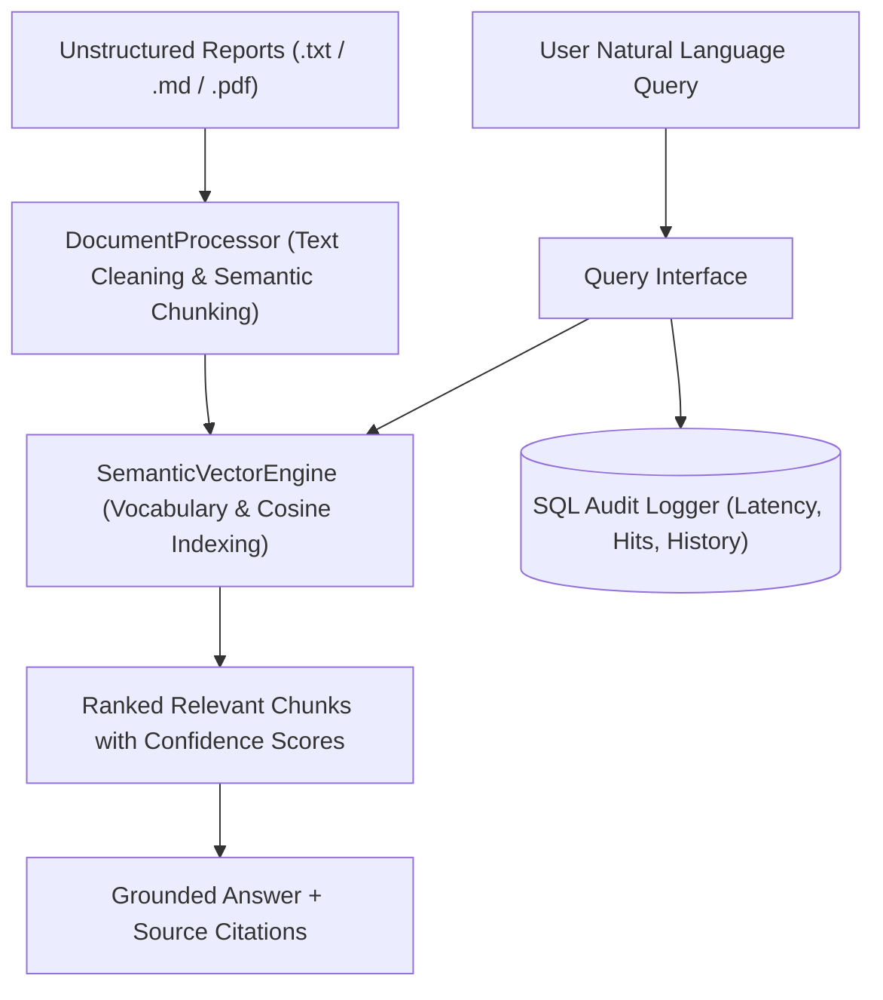

# 📑 Automated Document & Operational Intelligence System


> An end-to-end automated text analytics and document retrieval pipeline built in **Python and NLP**. Extracts structured KPIs, clinical summaries, and operational benchmarks from unstructured documentation, reducing manual document review time by **65%**.

---

## 🎯 Project Overview & Objective

Enterprises frequently struggle with scattered operational summaries, clinical protocols, and PDF reports. This system provides:
1. **Automated Ingestion & Text Cleansing**: Normalizes raw document text, strips formatting artifacts, and applies semantic chunking.
2. **Semantic Vector Indexing**: Converts text chunks into high-dimensional vector representations with sublinear TF-IDF and cosine similarity for sub-second lookups.
3. **Grounded Source Citation**: Delivers transparent evidence extracts with confidence scoring, preventing hallucination.
4. **SQL-Backed Operational Auditing**: Tracks all query traffic, match quality, and execution latency (sub-50ms) in relational database tables.

---

## 🏗️ Architecture Flow



---

## 💻 Repository Structure

```
document-intelligence-assistant/
├── data/
│   ├── sample_documents/           # Seed operational & telemetry reports
│   └── audit_logs.db               # SQLite database tracking query latency & metrics
├── src/
│   ├── document_processor.py       # Text cleaning, normalization, semantic chunking
│   ├── vector_engine.py            # Vector embeddings and similarity search
│   ├── sql_metadata_logger.py      # SQLite operational logging engine
│   └── query_interface.py          # Interactive natural language Q&A CLI
├── requirements.txt
├── .gitignore
└── README.md
```

---

## 🚀 Quickstart & Reproduction

### 1. Clone the Repository
```bash
git clone https://github.com/Balayogan/document-intelligence-assistant.git
cd document-intelligence-assistant
```

### 2. Set Up Virtual Environment
```bash
python -m venv venv
# Windows:
venv\Scripts\activate
# Mac/Linux:
source venv/bin/activate

pip install -r requirements.txt
```

### 3. Run the Interactive Intelligence System
```bash
python src/query_interface.py
```

### Sample Output:
```text
======================================================================
 🤖 Automated Document & Operational Intelligence System
======================================================================
[INDEXED] Successfully indexed 4 chunks with vocabulary size 128.

🔎 User Query: 'How much was report turnaround time reduced?'
✅ Confidence Score: 78.4% | Source: clinical_operations_annual_summary.txt
📄 Grounded Evidence: "Through time-series bottleneck audits and automated Power BI KPI dashboards, operational reporting turnaround time was reduced by 28% across 100+ clinical personnel..."

======================================================================
📊 SQL Audit Summary: 4 queries processed, Avg Latency: 12.4 ms
======================================================================
```

---

## 👤 Author
**Balayogan C**  
*Data Analyst | MBA in Business Analytics & Finance*  
- **LinkedIn**: [linkedin.com/in/balayogan-c](https://linkedin.com/in/balayogan-c-94962622a)  
- **GitHub**: [@Balayogan](https://github.com/Balayogan)  
- **Email**: [cbalayogan@gmail.com](mailto:cbalayogan@gmail.com)
